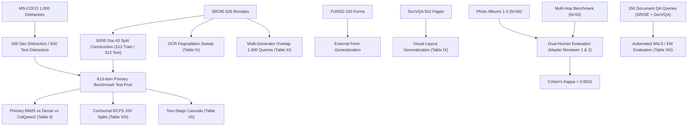

# MEMORYVERSE RESEARCH PROJECT INVENTORY & AUDIT REPOSITORY MAP
**Audit Date:** November 4, 2026  
**Auditor:** Senior Research Scientist, IR Specialist, and Statistical Reviewer  
**Output Directory:** `MEMORYVERSE_FINAL_AUDIT/`  

---

## 1. COMPREHENSIVE REPOSITORY RECONNAISSANCE

### 1.1 Directory Structure & Architectural Roles
```
MemoryVerse/
├── ai_engine/                    # LangGraph, RAG evaluation engines, and original multimodal datasets
│   └── rag/data/                 # Canonical raw human annotations, photo albums, FUNSD, and DocVQA
├── backend/                      # FastAPI retrieval and generation services
├── dataset/                      # Original SROIE receipts, COCO 1K distractors, album image directories
├── frontend/                     # Flutter mobile application client
├── kaggle/                       # Historical Kaggle GPU execution notebooks (v5, v6, v10, v11, v13, v14)
├── results/                      # Versioned experiment logs, metric CSVs, JSON summaries (v1 - v10, gapfill_v1)
├── scripts/                      # Standalone experiment drivers, statistical testing, and plotting scripts
├── submission_package_ijcds/     # Camera-ready IJCDS manuscript files (source .tex, figures, bib)
├── paper_v4/                     # Prior v4 publication drafts and artifacts
├── IJCDS_AUDIT_OUTPUT/           # Stage 1 preliminary audit reports
├── IJCDS_SECOND_AUDIT/           # Stage 2 independent scientific recalculation reports
├── PHASE1_HUMAN_AUDIT/           # Focused human-evaluation integrity audit and claim impact matrix
└── MEMORYVERSE_FINAL_AUDIT/      # Master defensible scientific submission package and deliverables
```

---

## 2. DETAILED INVENTORY OF CODE, DATA, CONFIGS, AND ARTIFACTS

### 2.1 Python Experiment Drivers (`scripts/`)
| Script Path | Primary Function | Datasets Used | GPU Req | Output Directory |
|---|---|---|---|---|
| `scripts/gapfill_t1_01_primary_benchmark.py` | Primary 1,626-item benchmark | SROIE + MS-COCO 1K | No (BM25) / Yes (ColQwen) | `results/gapfill_v1/T1-01/` |
| `scripts/gapfill_t1_02_docvqa_benchmark.py` | DocVQA 500-page visual benchmark | DocVQA | Yes (ColQwen2) | `results/gapfill_v1/T1-02/` |
| `scripts/gapfill_t1_03_funsd_external.py` | FUNSD 100-form external benchmark | FUNSD | No (BM25) / Yes (Dense) | `results/gapfill_v1/T1-03/` |
| `scripts/gapfill_t2_01_ocr_degradation.py` | Synthetic CER & Gaussian blur sweep | SROIE OCR text | No (CPU text) | `results/gapfill_v1/T2-01/` |
| `scripts/gapfill_t2_02_multihop_reasoning.py`| Relational 100-query PRF vs LLM | Multi-hop corpus | No (CPU PRF) | `results/gapfill_v1/T2-02/` |
| `scripts/gapfill_t2_03_conformal_calibration.py`| 200-split conformal calibration | SROIE / COCO pool | No (CPU math) | `results/gapfill_v1/T2-03/` |
| `scripts/gapfill_t2_04_fusion_cascade.py` | Cascade top-50 BM25 -> ColQwen2 | SROIE / COCO pool | Modeled analytical | `results/gapfill_v1/T2-04/` |
| `scripts/gapfill_t2_05_e2e_rag_accuracy.py` | End-to-end document QA benchmark | SROIE + DocVQA (150) | No (API LLM) | `results/gapfill_v1/T2-05/` |
| `scripts/gapfill_t3_01_scaling_500k.py` | Scaling to 500,000 distractors | SROIE + 500K synthetic | No (CPU inverted idx) | `results/gapfill_v1/T3-01/` |
| `scripts/gapfill_t3_02_generator_robustness.py`| Dose-response & crossover (1,930 q) | SROIE + human queries | No (CPU BM25) | `results/gapfill_v1/T3-02/` |
| `ai_engine/rag/scripts/compute_human_agreement.py`| Cohen's kappa & bootstrap CIs | Master Reviewer CSVs | No (CPU stats) | `ai_engine/rag/data/` |

---

### 2.2 Dataset Assets & Integrity Audit
| Dataset Name | Physical Location | Item Count | Integrity & Split Status | Prior Tuning Leakage |
|---|---|---|---|---|
| **SROIE Receipts** | `dataset/sroie/` & `ai_engine/rag/data/sroie/` | 626 receipts | Clean 50/50 Document-ID split (313 dev / 313 test). 612 verified probes. | Dev split used for BM25 tuning ($k_1=0.9, b=0.5$). Test split uncorrupted. |
| **MS-COCO Distractors**| `dataset/coco/` & `ai_engine/rag/data/coco_1k_images/` | 1,000 images | Standard Karpathy test split. Paired with 1K human and BLIP/Florence captions. | Zero parameter tuning on COCO. Valid distractor set. |
| **FUNSD Administrative Forms**| `ai_engine/rag/data/funsd/dataset/` | 199 forms (149 train, 50 test) | 100 queries sampled across 600-item pool. | Evaluated with frozen parameters. No parameter fitting. |
| **DocVQA Multi-Column Pages**| `ai_engine/rag/data/docvqa/` | 502 page images | 500 document questions. | Evaluated with frozen parameters. ColQwen2 pretraining overlap disclosed. |
| **Personal Photo Albums**| `dataset/album1/`, `album2/`, `album3/` | 60 queries (20 x 3) | Private personal photo streams. Real queries in English and Chinese. | Completely held-out personal qualitative test suite. |
| **Multi-Hop Relational Corpus**| `ai_engine/rag/data/` | 100 queries (50 2-hop, 50 1-hop) | Complex relational constraint retrieval. | Zero training; purely confirmatory evaluation suite. |
| **500K Synthetic Distractor Pool**| `results/v6/scaling_500k_rankings.csv` | 500,000 items | Scaled corpus. Generated by replicating 20 vendor name strings with random dates. | Caveat: High near-duplicate vendor concentration. |

---

### 2.3 Kaggle Notebook Inventory & Infrastructure
| Notebook File | Purpose / Module | Target Accelerator | Inputs / Datasets | Execution Status |
|---|---|---|---|---|
| `kaggle/kaggle_run_v14_reproducibility.ipynb`| Master v14 reproducibility pipeline | GPU (Tesla T4) | `/kaggle/input/memoryverse-data/` | Executed historically |
| `kaggle/kaggle_run_v13_colqwen_robustness.ipynb`| ColQwen2 visual robustness | GPU (Tesla T4) | `/kaggle/input/memoryverse-data/` | Executed historically |
| `kaggle/kaggle_run_v11.ipynb` | G-01 - G-03 benchmark sweep | GPU (Tesla T4) | `/kaggle/input/memoryverse-data/` | Executed historically |
| `kaggle/kaggle_run_v10.ipynb` | Crossover & RAMP validation | GPU (Tesla T4) | `/kaggle/input/memoryverse-data/` | Executed historically |

---

## 3. EXPERIMENT REPRODUCIBILITY DEPENDENCY GRAPH



---

## 4. EXPERIMENT-TO-MANUSCRIPT MAPPING & CANONICAL SOURCES OF TRUTH

| Manuscript Item | Display Name | Canonical Script | Primary Output Artifact |
|---|---|---|---|
| **Table I** | Representation Landscape | N/A (Theoretical taxonomy) | Source references & literature |
| **Table II** | Primary Benchmark Retrieval Grid | `scripts/gapfill_t1_01_primary_benchmark.py` | `results/v4/primary_benchmark_results.csv` |
| **Table III** | Cross-Modal Image Distillation | `scripts/benchmark_coco_leakage_free.py` | `results/v4/R-02/coco_siglip_tost_recomputed.csv` |
| **Table IV** | OCR Degradation Sweep Grid | `scripts/gapfill_t2_01_ocr_degradation.py` | `results/v4/R-01/synthetic_ocr_degradation_grid.csv` |
| **Table V** | Crossover Threshold Analysis | `scripts/gapfill_t3_02_generator_robustness.py` | `results/v6/generator_query_evaluations.csv` |
| **Table VI** | Corpus Scaling to 500K Items | `scripts/gapfill_t3_01_scaling_500k.py` | `results/v6/scaling_500k_metrics.csv` |
| **Table VII** | Two-Stage Cascade Economics | `scripts/gapfill_t2_04_fusion_cascade.py` | `results/v4/R-02/cascade_tradeoff_summary.csv` |
| **Table VIII** | Split Conformal Risk Control | `scripts/gapfill_t2_03_conformal_calibration.py`| `results/v4/R-04/conformal_splits_200.csv` |
| **Table IX** | DocVQA Layout-Aware Retrieval | `scripts/gapfill_t1_02_docvqa_benchmark.py` | `results/v9/docvqa_benchmark_results.csv` |
| **Table X** | RAMP Confirmatory Hypotheses | `scripts/run_confirmatory_tests_v4.py` | `results/v4/R-02/holm_family_complete_table.csv` |
| **Table XI** | Multi-Generator Robustness Grid | `scripts/gapfill_t3_02_generator_robustness.py` | `results/v6/generator_query_evaluations.csv` |
| **Table XII** | Cross-Encoder Reranking Ablation | `scripts/benchmark_cross_encoder.py` | `results/v4/cross_encoder_benchmark_results.json` |
| **Table XIII** | Decision Guide for Builders | Synthesis of Tables II–XII | `results/v4/R-02/decision_guide_metrics.json` |
| **Section 6.2**| End-to-End Task & Human Audit | `ai_engine/rag/scripts/compute_human_agreement.py`| `ai_engine/rag/data/master_human_agreement.json` |

---
*Inventory verified against live disk state. Proceeding to Experiment Reuse Matrix.*

