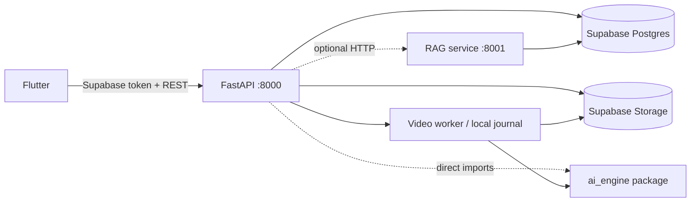

# Existing architecture and target boundary

## Actual request flow

The implementation is hybrid: the backend can call the RAG process, but also
imports the same AI package directly. This is operationally simpler for local
development but means model dependencies and security assumptions are shared.

## Frontend structure

`frontend/lib/main.dart` bootstraps Supabase and Riverpod. `router.dart`
provides auth-aware GoRouter navigation and an indexed shell for home,
timeline, memories, and profile. `app_repositories.dart` owns REST contracts;
providers own async screen state. Upload and video-job controllers implement
retry/progress/SSE-or-polling behavior.

## Backend structure

`backend/app/api/` contains route modules for auth, vaults, media, memories,
search, timeline, AI, sessions, notifications, and profile. Services in
`backend/app/services/` contain storage, extraction, search, orchestration, and
video-job logic. `core/security.py` authenticates through Supabase and now only
allows local JWT validation when explicitly enabled.

## Target boundary for production

- Browser/mobile clients call only the backend.
- The backend authenticates users and passes a short-lived, internal service
  credential to the private AI service when remote execution is enabled.
- Every media/vector query carries an application-derived tenant ID; callers do
  not choose an identity outside trusted backend code.
- Original media remains in private object storage. Postgres stores metadata,
  job state, and vectors; it is not a file store.
- Expensive work is asynchronous and returns a job ID with observable state.
